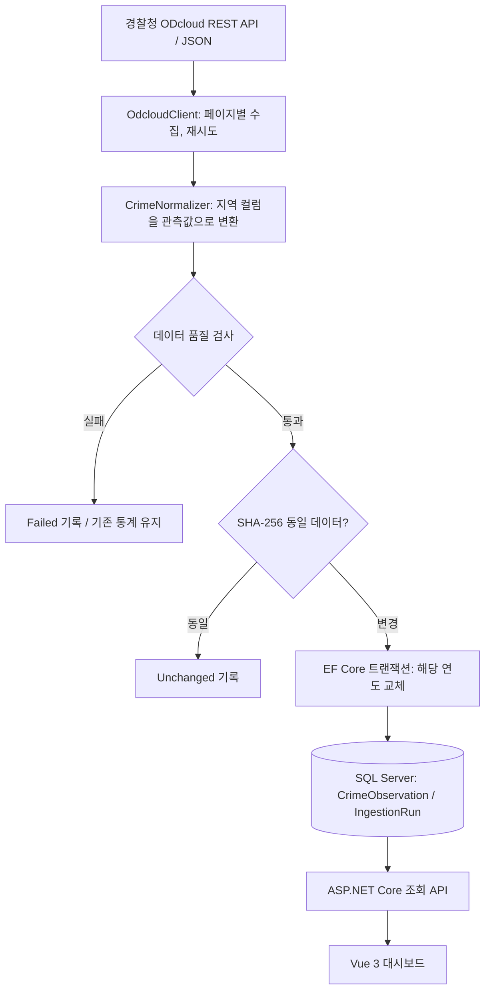

# 공공데이터를 활용한 범죄 현황 웹사이트

**CRIMAP INSIGHT** · 경찰청 지역별 범죄 발생 통계 시각화 프로젝트  
`C#` `ASP.NET Core 8` `EF Core 8` `SQL Server 2022` `Docker` `Vue 3` `TypeScript` `Vite`  
**개인 프로젝트 · AI 협업 개발 · 로컬 실행/검증 · 별도 공개 서비스 미배포**

> **무엇을 만들었나?** 경찰청이 공개한 **연도별·지역별 범죄 발생 통계**를 REST API로 수집하고, 데이터를 검사·정규화하여 DB에 저장한 뒤 지역별 현황과 범죄 유형을 비교할 수 있는 웹사이트입니다. CSV 파일을 수동 업로드하는 방식은 사용하지 않았습니다.
>
> **해석 주의:** 이 데이터는 **실시간 사건 정보나 특정 장소의 위험도**가 아닙니다. 지역 간 **발생 건수 차이**를 보여주며, 인구 규모를 보정한 안전도 순위가 아닙니다.


## 1. 프로젝트 한눈에 보기

| 구분 | 내용 |
|---|---|
| 목적 | 원본 공공데이터를 활용해 **어느 지역에서 어떤 유형의 범죄가 얼마나 발생했는지** 한눈에 파악하고 비교할 수 있도록 구성 |
| 데이터 출처 | [공공데이터포털 — 경찰청 범죄 발생 지역별 통계](https://www.data.go.kr/data/3074462/fileData.do) (ODcloud REST API, JSON) |
| 핵심 작업 | API 호출·페이징, 원본 필드 정규화, 데이터 품질 검증, 트랜잭션 적재, 통계 API, Vue 대시보드 |
| 형태 | **C# REST API + MSSQL + Vue SPA** (프론트와 백엔드 분리) |
| 실행 범위 | 개발자 PC에서 Docker SQL Server와 ASP.NET Core API 및 Vue를 실행하는 **로컬 포트폴리오** |
| 개발 방식 | AI가 코드 작성·수정안을 생성하고, **본인이 요구사항·구현 방향·수정 요청을 제시하고 로컬 환경에서 동작과 데이터 반영을 확인** |

### 사용 기술과 이유

| 영역 | 기술 | 실제 사용 목적 |
|---|---|---|
| 프론트엔드 | Vue 3, TypeScript, Vite, CSS, Lucide Vue | 상태 기반 화면 구성, 필터·지역 선택, 현황/비교/관리 화면 |
| 백엔드 | C#, ASP.NET Core 8 Minimal API | 조회·비교·동기화 REST 엔드포인트 |
| 데이터 접근 | EF Core 8, LINQ | 통계 합계/그룹별 쿼리 및 트랜잭션 처리 |
| 외부 데이터 | 경찰청 ODcloud REST API, `HttpClient`, `System.Text.Json` | 연도별 JSON 데이터 수집과 페이지 처리 |
| DB / 실행 | SQL Server 2022, Docker Compose | 정규화된 관측값 및 동기화 실행 이력 저장 |
| 검증 / 개발 | xUnit, Swagger UI, SSMS, Visual Studio, VS Code, Git/GitHub | 정규화·API 클라이언트 테스트 코드, API·DB 확인 및 버전 관리 |

## 2. 주요 구현 화면

| 기능 | 실제 로컬 실행 화면 |
|---|---|
| **현황판 / 시·도 타일맵** · 연도·범죄 분류·지역 필터, 상위 범죄 유형 및 지역별 발생 건수 |  |
| **지역 순위 / 상세 조회** · 지역 선택에 따른 범죄 중분류별 수치 조회 |  |
| **두 지역 비교** · 동일 연도 기준 지역 A/B의 절대 발생 건수와 유형별 비교 |  |
| **데이터 수집 이력** · 관리자 동기화, 원본 행 수·관측값·지역 수·처리 상태 표시 |  |
| **데이터 안내 / 해석 범위** · 데이터 출처 및 실시간 현황과의 차이 명시 |  |

> 위 이미지는 사용자가 **로컬 환경에서 직접 실행해 촬영한 화면**입니다. 특정 시점의 화면 예시로, 서버가 항상 실행되고 있거나 웹서비스가 배포되어 있다는 뜻은 아닙니다. 지도는 실제 GIS 행정경계가 아닌 **시·도 타일맵**입니다.

## 3. 백엔드 아키텍처와 데이터 흐름



원본 API는 **범죄 대/중분류가 한 행에 있고 지역명이 각각 열로 존재하는 구조**입니다. 이를 조회하기 쉬운 **`연도 + 지역 + 범죄대분류 + 범죄중분류 + 발생 건수`** 형태의 관측값으로 변환합니다. DB에는 이 조합에 복합 유니크 인덱스가 설정되어 있습니다.

- **수집 신뢰성:** `totalCount`와 전체 수신 행 수를 대조하고, 페이지 사이 건수 불일치·빈 페이지·API 인증 실패를 검출합니다. 429/5xx 오류에는 제한적 재시도를 수행합니다.
- **품질 검사:** 분류 누락, 지역 열 인식 실패, 음수/NULL/부적합 숫자, 동일 키 중복을 실패로 처리합니다. 잘못된 수치가 정상 데이터처럼 섞이지 않게 하기 위한 정책입니다.
- **중복 수집 처리:** 정규화한 자료의 **SHA-256**을 비교해 이전 성공 수집본과 동일하면 `Unchanged`로 기록합니다.
- **교체 원자성:** 자료가 변경되면 해당 연도의 기존 관측값 삭제와 새 관측값 삽입을 **하나의 DB 트랜잭션**에서 수행하도록 작성했습니다.
- **추적 가능성:** `IngestionRun`에 실행 시각, 성공/실패 상태, 원본 행 수, 관측값 수, 지역 수, 해시, 오류 요약을 기록합니다.

**2025년 로컬 수집 결과 (사용자 실행 기록):** 원본 **38행** → 정규화 관측값 **8,702개** → 구분된 지역 **229개**. 여기서 **8,702는 범죄 발생 건수가 아니라 데이터베이스 관측 레코드 개수**입니다. 대시보드의 '총 발생 건수'와 구분해야 합니다.

### 제공 API

| 메서드 | 경로 | 역할 |
|---|---|---|
| `GET` | `/api/meta`, `/api/regions`, `/api/categories` | 데이터 범위·지역·분류 조회 |
| `GET` | `/api/summary` | 전체 합계, 지역·범죄 대분류별 집계 |
| `GET` | `/api/breakdown` | 선택 지역 세부 범죄 건수 |
| `GET` | `/api/compare` | 두 지역 비교 |
| `GET` | `/api/trends` | DB에 저장된 연도별 추이 |
| `GET` | `/api/pipeline/runs` | 데이터 적재 이력 조회 |
| `POST` | `/api/admin/sync/{year}` | `X-Admin-Key` 확인 후 해당 연도 데이터 수집 |

자세한 명세: [`docs/api-endpoints.md`](docs/api-endpoints.md) · 구현: [`Program.cs`](backend/CrimeInsight.Api/Program.cs), [`IngestionService.cs`](backend/CrimeInsight.Api/Services/IngestionService.cs), [`CrimeNormalizer.cs`](backend/CrimeInsight.Api/Services/CrimeNormalizer.cs)

## 4. AI와 함께 개발한 과정 및 시행착오

이 프로젝트는 **AI가 생성한 코드를 그대로 개인 수작업 구현이라고 소개하지 않습니다.** 요구사항과 판단 근거를 제시하고, 실제 실행 결과와 문제가 발생한 지점을 바탕으로 수정 방향을 반복한 **AI 협업 개인 프로젝트**입니다.

| 단계 | 실제로 마주친 상황 | 대응과 배운 점 |
|---|---|---|
| ① 데이터 소스 선택 | 포트폴리오에서 단순 CSV 적재보다 **외부 API와 데이터 처리 흐름**을 보여주고 싶었음 | 경찰청 ODcloud **REST JSON 수집**을 요구사항으로 정하고, 수집·정규화·저장·조회 단계를 분리 |
| ② SQL Server 실행 | Docker SQL Server의 로컬 **1433 포트가 이미 점유**됨 | 컨테이너 1433은 유지하고 **호스트 포트를 11433으로 변경**. 호스트/컨테이너 포트 개념 구분 |
| ③ DB 인증 | 앱 계정이 존재하지 않거나 권한이 없어 **SQL Server 18456** 로그인 오류가 발생 | SSMS에서 접속 계정과 DB 존재 여부를 확인하고 연결 문자열·로그인 권한을 점검. API 오류와 DB 인증 오류를 분리해 진단 |
| ④ 데이터 적재 확인 | API 응답 성공만으로 데이터가 제대로 저장되었는지 판단하기 어려움 | 동기화 결과의 **38/8,702/229**를 확인하고 SQL Server 저장 및 통계 조회 API 결과를 비교 |
| ⑤ 프론트엔드 재구성 | 초기 React 화면을 만든 뒤, 범죄 통계 서비스보다 **홍보 페이지에 가까운 인상**이 있었음 | UI 목적을 재정의하고 **Vue 3로 교체**, 어두운 배경·붉은 강조색·현황판/비교 중심으로 개편 |
| ⑥ 지역 상세 오류 | 선택 지역의 상세 결과가 보이지 않거나 실패 이유를 알기 어려웠음 | 지역 선택 시 `/api/breakdown`·`/api/trends` 재조회, 로딩·에러 문구·**다시 조회**·빈 결과 상태를 분리 |
| ⑦ 개발 서버 충돌 | Vite 실행 시 **5173 포트 사용 중** 오류 | 기존 Node/Vite 프로세스 확인·종료 후 다시 실행하거나 포트 변경. 코드 오류와 실행환경 문제를 구분 |
| ⑧ 배포 검토 | 프론트만 외부에 올리면 로컬 `localhost:5088`의 API 및 Docker DB에 접근할 수 없음 | 운영 환경/보안 비용을 검토한 뒤 **현재는 배포하지 않고 GitHub 포트폴리오로 보관**하기로 결정 |

**추가로 확인한 오류 UI:** API 서버가 중지된 경우 사용자에게 연결 실패 메시지를 보여줍니다. 아래 화면은 **정상 동작 증빙이 아닌 실패 시나리오 예시**입니다.


### 본인의 수행 범위와 AI 기여 범위

| 구분 | 범위 |
|---|---|
| **본인** | 프로젝트 목표·요구사항 정의, CSV 대신 REST API 선택, C#/SQL Server 기반 구조 및 시각화 방향 지정, 화면 피드백과 수정 요청, Docker·DB 연결 문제 확인, API·DB·화면 로컬 동작 검증, GitHub 공개 범위·미배포 결정 |
| **AI 활용** | 설계/구현 대안 제시, C# API·수집/검증 로직·Vue 코드 초안 및 수정본 생성, 문제 원인 분석 지원, 문서화 지원 |
| **외부 제공** | 데이터: 경찰청 공공데이터포털. 오픈소스 라이브러리: 위 기술 스택에 명시 |

> 코드를 AI와 함께 만들었다는 사실과 **어디를 직접 검토·실행·검증했는지**를 구분했습니다. 특정 소스 전체를 AI 도움 없이 직접 작성했다고 주장하지 않습니다.

## 5. 확인한 결과와 검증의 한계

| 구분 | 확인한 내용 | 확인 근거/한계 |
|---|---|---|
| 수집 동기화 | `POST /api/admin/sync/2025` 성공 기록 | 로컬 실행 보고: 원본 38행, 관측값 8,702개, 지역 229개 |
| 데이터 저장·조회 | MSSQL 데이터 직접 조회 및 통계 API 확인 | 사용자의 로컬 검증 보고, 현재 원격 DB 접속 테스트와는 별개 |
| 화면 | 현황판, 지역 비교, 데이터 확인, 안내 및 실패 메시지 표시 | 실제 실행 화면 캡처 7장 |
| 자동화 테스트 | 정규화 오류 및 ODcloud 페이지 검증에 대한 xUnit 테스트 코드 존재 | [`CrimeNormalizerTests.cs`](backend/CrimeInsight.Tests/CrimeNormalizerTests.cs), [`OdcloudClientTests.cs`](backend/CrimeInsight.Tests/OdcloudClientTests.cs). **이 README 수정 작업에서 테스트를 재실행한 것은 아님** |
| 공개 서비스 | **미배포** | GitHub 코드 저장소만 공개. 온라인 데모·상시 API 제공은 없음 |

## 6. 로컬 실행

필요: **.NET 8 SDK / Docker Desktop / Node.js / SQL Server용 계정 / 경찰청 ODcloud API 인증키**

```powershell
# 1. 프로젝트 루트에서 로컬 DB 설정(.env는 GitHub에 커밋하지 않음)
Copy-Item .env.example .env
# .env의 MSSQL_SA_PASSWORD를 본인 로컬 비밀번호로 설정

docker compose up -d

# 2. 백엔드 설정: 로컬 환경변수 또는 dotnet user-secrets에 저장
# ConnectionStrings__CrimeInsight, OpenData__ServiceKey, Admin__SyncKey 설정
# DB 접속 계정은 SQL Server에서 미리 생성/권한 설정 필요

dotnet run --project .\backend\CrimeInsight.Api --launch-profile http

# 3. 새 PowerShell 창에서 Vue 실행
cd frontend
npm install
npm run dev
```

- 프론트: `http://localhost:5173`
- API: `http://localhost:5088/api/health`
- Swagger: `http://localhost:5088/swagger` (**개발 환경용**)
- Docker MSSQL 호스트 포트: `127.0.0.1:11433` (컨테이너 내부 1433)
- 로컬 설정 예시: [`.env.example`](.env.example), [`frontend/.env.example`](frontend/.env.example)

> **비밀정보:** `OpenData__ServiceKey`, `Admin__SyncKey`, DB 계정·비밀번호는 **백엔드 비밀 설정**에 보관합니다. `VITE_*` 변수는 클라이언트 번들에 노출될 수 있으므로 인증키를 넣지 않습니다. `Docker Compose`의 SQL Server 에디션은 `Developer`로 개발/테스트 목적입니다.

## 7. 현재 한계와 개선할 부분

- **발생 건수 ≠ 범죄 위험도**: 인구·유동인구 보정, 분류체계/행정구역 변화 반영이 없습니다. 지역을 안전도 순위로 해석하면 안 됩니다.
- **실제 지도 아님**: 현재 시각화는 시·도별 사각 타일맵입니다. 지도 좌표·경계 기반 분석은 미구현입니다.
- **다중 서버 동시 수집 미대응**: `SemaphoreSlim`은 단일 프로세스에서만 동작합니다. 운영 확장 시 분산 잠금이 필요합니다.
- **DB 운영·보안 보완 필요**: `EnsureCreatedAsync` 대신 마이그레이션, Swagger 운영 제한, 관리자 API 접근 통제·요청 제한, 최소 권한 DB 계정 및 키 교체 정책이 필요합니다.
- **연도별 추이 제약**: 동기화한 연도만 표시되며, 연도 간 분류체계·행정구역 변경은 자동 보정하지 않습니다.
- **서버 장애 시 상태 표기 보완**: 오류 문구는 표시하지만 이전에 읽은 숫자가 화면에 남을 수 있습니다. 연결 상태와 자료의 최신성 표시를 분리하는 개선이 필요합니다.
- **배포하지 않음**: 백엔드 및 DB 호스팅·운영 보안을 준비하지 않았으며, 현재는 GitHub에서 코드와 실행 화면으로만 소개합니다.

---

**이 프로젝트를 통해 설명할 수 있는 것:** 외부 API 데이터 수집·스키마 파악, 정규화 과정과 복합키, 품질 검증 정책, 동일 데이터 재수집 처리, EF Core 트랜잭션, REST 집계 API, Vue와 서버 연동, 로컬 Docker/SQL Server 장애 진단, AI 협업 시 자신의 역할과 검증 범위 구분.