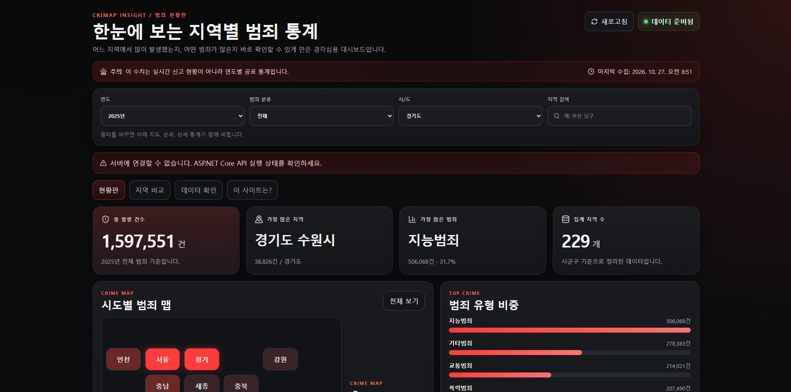
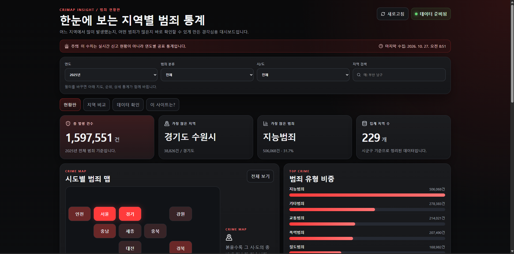
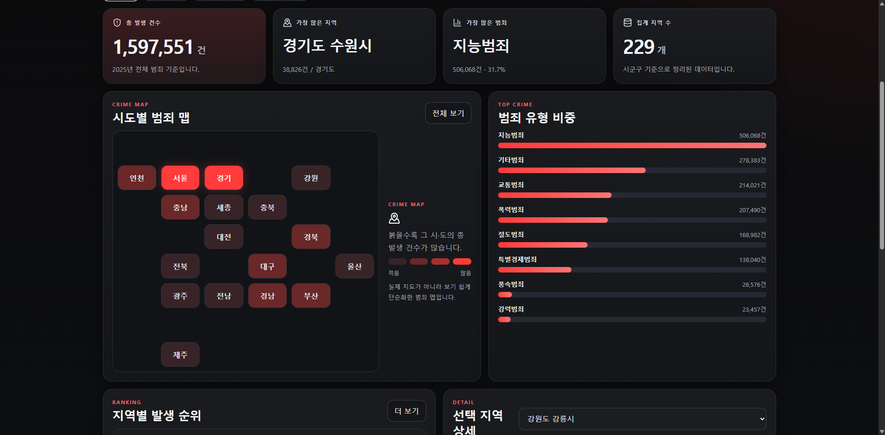
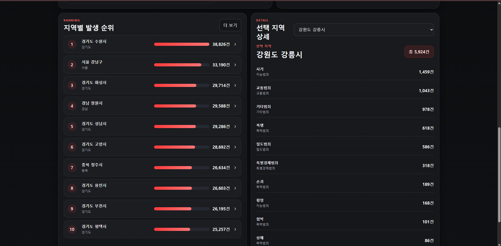
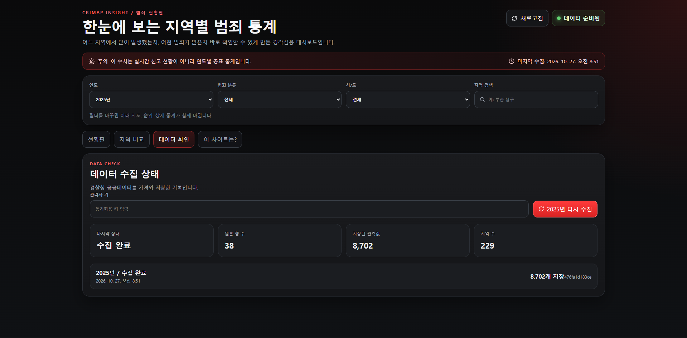
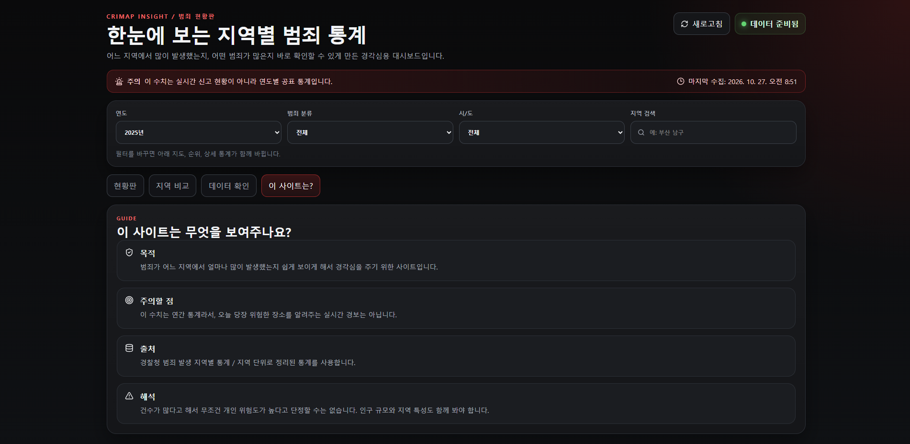

# 공공데이터를 활용한 범죄 현황 웹사이트

**CRIMAP INSIGHT**는 경찰청 범죄 통계를 API로 수집해 DB에 저장하고, 지역별 발생 건수와 범죄 유형을 비교하는 웹사이트입니다.

C# · ASP.NET Core 8 · EF Core · MSSQL 2022 · Docker · Vue 3 · TypeScript · Vite



## 중점적으로 구현한 부분

화면에 통계만 표시하는 것보다, **외부 데이터를 가져와 검사하고 DB에 저장한 뒤 조회하는 과정**을 연결해 보고 싶었습니다. CSV 파일을 직접 넣는 대신 REST API로 원본 데이터를 수집하도록 구성했습니다.

| 구간 | 구현 내용 |
| --- | --- |
| 수집 | 경찰청 ODcloud REST API 호출, 페이지별 데이터 수신 |
| 검증·변환 | 원본 지역 열을 조회용 데이터로 변환, 누락·중복·잘못된 숫자 검사 |
| 저장 | EF Core로 MSSQL 적재, 동일 데이터 확인, 연도별 데이터 교체 |
| 조회 | 지역·범죄 유형별 집계, 지역 상세, 두 지역 비교 API |
| 화면 | Vue에서 필터·지역 선택·비교 결과·수집 이력 표시 |

**개인 프로젝트로 AI와 함께 개발했습니다.** 필요한 기능과 기술 구성을 정하고 AI에 코드 생성·수정을 요청했습니다. 실행 중 발생한 오류와 화면 피드백을 전달하며 수정했고, DB 저장 결과와 조회 API, 화면의 연결을 확인했습니다.

## 사용 기술

| 구분 | 사용한 기술과 용도 |
| --- | --- |
| 백엔드 | C#, ASP.NET Core 8 Minimal API — 통계 조회·데이터 수집 API |
| 데이터 처리 | HttpClient, System.Text.Json — 외부 JSON 수집·해석 |
| DB | MSSQL 2022, EF Core, LINQ — 저장·집계·트랜잭션 |
| 프론트엔드 | Vue 3, TypeScript, Vite — 조회 조건과 API 결과를 화면에 반영 |
| 실행·개발 도구 | Docker Compose, Visual Studio, VS Code, SSMS, Swagger, Git/GitHub |
| 테스트 | xUnit — 데이터 변환·검증, 외부 API 페이지 처리 테스트 코드 |

## 주요 화면

### 현황판과 지역 상세

연도·범죄 분류·지역을 선택해 발생 건수와 범죄 유형을 확인합니다. 시·도 타일을 선택하고 지역별 목록에서 상세 수치를 조회할 수 있습니다.



<details>
<summary>지역별 순위와 선택 지역 상세 화면</summary>



</details>

### 두 지역 비교

같은 연도의 두 지역을 선택해 전체 건수와 범죄 유형별 수치를 비교합니다.



### 데이터 수집 이력

수집 상태와 원본 행 수, 변환한 관측값 수, 지역 수를 표시합니다.



첨부 화면은 직접 실행해 촬영한 자료입니다. **발생 건수 통계**이며 실시간 사건 정보나 인구를 보정한 위험도 순위는 아닙니다. 지도 표현은 실제 행정경계가 아닌 시·도 타일맵입니다.

## 데이터 처리 흐름

| 단계 | 처리 내용 |
| --- | --- |
| 1. 데이터 수집 | 경찰청 API에서 페이지별 JSON 데이터를 가져옵니다. |
| 2. 변환·검증 | 조회용 형식으로 바꾸고 누락·중복·잘못된 숫자를 검사합니다. |
| 3. 기존 자료와 비교 | 정리한 데이터의 해시값을 이전 성공 수집본과 비교합니다. |
| 4-1. 동일한 경우 | `Unchanged` 이력을 남기고 기존 자료를 유지합니다. |
| 4-2. 변경된 경우 | 하나의 트랜잭션에서 해당 연도의 기존 자료를 새 자료로 교체합니다. |
| 5. 통계 조회 | MSSQL에 저장된 자료를 통계 API로 조회하여 Vue 화면에 표시합니다. |

### 원본 데이터를 조회하기 쉬운 형태로 바꾸기

원본에는 범죄 대·중분류가 행으로, 지역명이 열로 들어 있습니다. 이를 `연도 + 지역 + 범죄대분류 + 범죄중분류 + 발생 건수` 형태로 바꿔 저장합니다.

분류 누락, 인식할 수 없는 지역 열, 음수·잘못된 숫자, 같은 조합의 중복은 오류로 처리합니다. 원본 구조가 달라졌을 때 잘못된 데이터를 정상 자료처럼 저장하지 않도록 구성했습니다.

[변환·검증 코드 — CrimeNormalizer](backend/CrimeInsight.Api/Services/CrimeNormalizer.cs)

### 같은 데이터를 다시 수집할 때

정규화한 값을 정렬한 뒤 SHA-256 해시를 만들어 이전 성공 수집본과 비교합니다. 같으면 `Unchanged`로 기록하고, 바뀌면 해당 연도의 기존 자료 삭제와 새 자료 삽입을 하나의 트랜잭션으로 처리합니다.

[수집·저장 코드 — IngestionService](backend/CrimeInsight.Api/Services/IngestionService.cs)

2025년 실행 기록에서는 **원본 38행 → 관측값 8,702개 → 지역 229개**를 확인했습니다. 여기서 8,702는 범죄 발생 건수가 아니라 변환해 저장한 레코드 수입니다.

## AI와 함께 진행한 과정

| 단계 | 제가 진행한 일 | AI를 활용한 부분 |
| --- | --- | --- |
| 기능 정리 | 외부 API 수집·DB 저장·통계 조회·비교 기능을 요청 | 구조와 구현안 제안, 코드 초안 생성 |
| 실행·연결 | Docker·DB·백엔드·화면을 실행하고 오류 확인 | 설정 방법과 오류 원인 분석 지원 |
| 화면 수정 | 초기 React 화면을 Vue로 변경 요청, 디자인과 조회 흐름 피드백 | Vue 코드 생성·수정 |
| 동작 확인 | DB 저장값·통계 API·화면 결과 확인, 상세 조회 문제 전달 | 조회 로직과 상태 표시 보완 |
| 문서 정리 | 수행 기록과 실제 화면 제공 | 코드·기록을 바탕으로 설명 정리 |

AI가 생성한 코드를 포함한 프로젝트입니다. 기능을 요청하는 데서 끝내지 않고, 실제 실행 결과를 바탕으로 다시 수정하는 과정을 반복했습니다.

## 실행하며 수정한 부분

### 선택한 지역의 상세 결과가 보이지 않았습니다

지역을 선택해도 상세 정보가 표시되지 않아 해당 동작을 확인하고 수정을 요청했습니다. Vue에서 지역 변경 시 `/api/breakdown`과 `/api/trends`를 다시 조회하고, **로딩·오류·빈 결과**를 구분해 표시하도록 보완했습니다. 실패했을 때 다시 조회할 수 있는 버튼도 추가했습니다.

이 과정에서 '결과가 안 보인다'는 현상만으로는 원인을 알기 어렵다는 점을 배웠습니다. 요청이 진행 중인지, 실패했는지, 데이터가 없는지를 화면에서 구분하는 것이 필요했습니다.

[화면 상태와 조회 처리 — App.vue](frontend/src/App.vue)

### Vue 개발 서버가 실행되지 않았습니다

`Port 5173 is already in use` 오류가 발생했습니다. 기존 Vite 서버가 사용 중인 포트와 프로세스를 확인한 뒤 다시 실행했습니다. 코드 문제와 이미 실행 중인 서버의 문제를 구분해 확인한 사례입니다.

### API 응답과 DB 저장 결과를 함께 확인했습니다

수집 요청의 성공 응답만 보지 않고 DB에 저장된 자료와 통계 API, 화면 결과를 확인했습니다. 원본 행 수와 저장 레코드 수가 다른 이유도 데이터 변환 구조를 통해 구분했습니다.

<details>
<summary>연결 실패 상태와 데이터 안내 화면</summary>


위 화면은 정상 조회 결과가 아닌 연결 실패 상태의 예시입니다.



</details>

## 코드와 확인 기록

| 확인할 내용 | 경로 |
| --- | --- |
| API 호출·페이지 처리 | [OdcloudClient.cs](backend/CrimeInsight.Api/Services/OdcloudClient.cs) |
| 데이터 변환·검증 | [CrimeNormalizer.cs](backend/CrimeInsight.Api/Services/CrimeNormalizer.cs) |
| 해시 비교·트랜잭션·수집 이력 | [IngestionService.cs](backend/CrimeInsight.Api/Services/IngestionService.cs) |
| EF Core 데이터 구조 | [CrimeDbContext.cs](backend/CrimeInsight.Api/Data/CrimeDbContext.cs) |
| API 엔드포인트 | [Program.cs](backend/CrimeInsight.Api/Program.cs) · [API 명세](docs/api-endpoints.md) |
| Vue 화면·API 연결 | [App.vue](frontend/src/App.vue) · [api.ts](frontend/src/lib/api.ts) |
| 테스트 코드 | [CrimeNormalizerTests.cs](backend/CrimeInsight.Tests/CrimeNormalizerTests.cs) · [OdcloudClientTests.cs](backend/CrimeInsight.Tests/OdcloudClientTests.cs) |

DB 저장 데이터·통계 조회 API·화면 연동은 개발 중 실행해 확인한 내용입니다. 테스트 코드는 저장소에 포함되어 있으며, 이번 README 수정 과정에서 새로 실행한 결과로 제시하지는 않습니다.

## 실행 방법

.NET 8 SDK, Node.js, Docker Desktop과 SQL Server 연결 계정, 공공데이터 API 인증키가 필요합니다.

1. 프로젝트 루트의 `.env.example`을 참고해 `.env`를 작성합니다.
2. `docker compose up -d`로 SQL Server를 실행합니다.
3. 백엔드의 환경변수 또는 User Secrets에 아래 항목을 설정합니다.

| 설정 | 용도 |
| --- | --- |
| `ConnectionStrings__CrimeInsight` | DB 연결 문자열 |
| `OpenData__ServiceKey` | 공공데이터 API 인증키 |
| `Admin__SyncKey` | 데이터 수집 요청 인증키 |

```powershell
dotnet run --project .\backend\CrimeInsight.Api --launch-profile http
```

별도 터미널에서 프론트엔드를 실행합니다.

```powershell
cd frontend
npm install
npm run dev
```

- 화면: `http://localhost:5173`
- API 상태: `http://localhost:5088/api/health`
- Swagger: `http://localhost:5088/swagger`
- Docker DB 호스트 주소: `127.0.0.1,11433`

공공데이터 API 키·DB 비밀번호·관리자 키는 서버 측 비밀 설정으로 관리합니다. 프론트엔드의 `VITE_*` 변수에는 넣지 않습니다.

## 더 보완할 부분

- 인구와 행정구역·범죄 분류 변화까지 고려한 비교 기준
- 연결 실패 시 이전 조회값과 최신 데이터 상태를 명확히 구분하는 표시
- 여러 서버 프로세스에서 동시에 수집하는 경우의 중복 실행 제어
