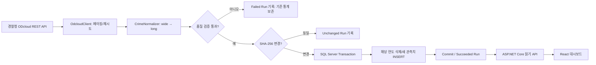

# 아키텍처와 데이터 품질 설계

## 1. 데이터 흐름

## 2. 데이터 모델

`CrimeObservation`: 한 관측값은 `Year + Region + CategoryMajor + CategoryMinor` 조합으로 유일합니다.

| 컬럼 | 유형 | 설명 |
|---|---|---|
| Year | int | 기준연도 |
| Region | nvarchar(100) | 원본 지역명 (예: 부산 남구) |
| Province | nvarchar(20) | 원본 지역명의 광역 접두어 |
| District | nvarchar(90) | 상세 행정구역 |
| CategoryMajor | nvarchar(80) | 범죄대분류 |
| CategoryMinor | nvarchar(80) | 범죄중분류 |
| Count | int | 발생 건수, 0 이상 |

`IngestionRun`: 원본 요청 시간, 상태, 원본 행 수, 정규화된 관측값 개수, 지역 수, 정규화 데이터 해시, 오류 요약.

## 3. 품질 규칙

- JSON 응답에 `data[]`, `totalCount`가 반드시 존재해야 합니다.
- 수신한 전체 행 수는 `totalCount`와 정확히 일치해야 합니다. 페이지 간 totalCount가 바뀌면 실패 처리합니다.
- 범죄 대/중분류가 누락된 행은 저장하지 않습니다. 전체 반영이 실패합니다.
- 공공데이터 컬럼명이 지역명 패턴에 부합하는 경우만 관측값으로 변환합니다.
- 숫자 음수, null, 부적합 문자열 및 동일 복합키 중복은 오류로 간주하고 **연도 전체 업데이트를 거부**합니다.
- 5개 미만의 지역만 인식한 응답은 형식 변경 가능성이 있어 거부합니다. (초기 휴리스틱)
- 성공 시 `SHA-256`을 보관해 동일 데이터의 반복 INSERT/DELETE를 방지합니다.
- 적용 시 특정 연도의 기존 관측값을 삭제한 후 신규 레코드를 INSERT합니다. 두 작업은 동일 DB 트랜잭션에 포함되어 오류 시 롤백됩니다.
- 전역 `SemaphoreSlim`으로 단일 애플리케이션 인스턴스의 동시 수집을 막습니다. **다중 인스턴스 운영 시 DB 기반 분산 잠금으로 교체해야 합니다.**

## 4. 제약과 향후 과제

- 2025년 기준 대구 군위군은 과거 다른 행정구역 기준과 다르게 분류됩니다. 이 구현은 원본 명칭을 보존하며 자동 환산을 하지 않습니다.
- 현재 자료만으로 인구 대비 발생률, 실제 치안 위험도, 실시간 범죄 위치를 계산할 수 없습니다.
- 향후: 별도 검증된 인구 API 연계, 지역 코드 마스터, 행정구역 변천 이력, 분류 변경표, 마이그레이션 기반 스키마 관리, OpenTelemetry 수집/추적.
- `EnsureCreatedAsync`는 로컬 MVP 용 초기 DB 생성입니다. 공유/운영 DB에서는 EF Core 마이그레이션으로 대체하세요.
- 테스트용 JSON은 통계 원본 데이터가 아닙니다. 서비스에 샘플 통계는 표시하지 않습니다.
